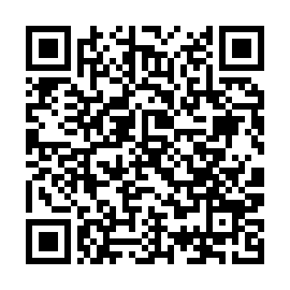

# GaugeBoy: OBD-II Deluxe

A homebrew app for the New Nintendo 3DS family that connects to a car's OBD-II port through a Wi-Fi ELM327 adapter. It reads check engine light codes, readiness monitors, fuel trims and live engine data, and shows them on the 3DS's two screens in a bright, playful style that looks and feels like a 3DS game.



**Install on a New 3DS with custom firmware:** open FBI, choose *Remote Install* > *Scan QR Code* and scan this code. It always installs the newest release. Then set up the adapter's Wi-Fi as described under [Install](#install).

> **Unofficial project.** GaugeBoy is an independent, fan-made homebrew project. It is not affiliated with, endorsed by or sponsored by Nintendo. Nintendo 3DS and New Nintendo 3DS are trademarks of Nintendo.

> **Safety.** GaugeBoy is not for use by the driver while driving. Use it parked, or let a passenger operate it. Performance timers are for closed courses and track days only.

## Status

**Early development: M2 live data done (0.2.0), M3 logging next.** The current release reads the car and its live data: **DIAG** shows the check engine light, readiness monitors, stored / pending / permanent codes with plain-English descriptions and the VIN, and clears codes behind a confirmation; **LIVE** shows the car's sensors in task-focused views with their refresh rates, battery voltage and manifold vacuum or boost; **TRIM** shows fuel trims for both banks. GaugeBoy finds the car by itself after connecting and shows its make, model and year. Everything is still on text screens except HOME: logging (M3) comes next, then the toy-like 3D gauges and the rest of the visual style (M4, UI polish), done once all the screens exist.

| Milestone | Version | Scope |
|---|---|---|
| M0 Spike | 0.0.x | Connect to the adapter, send `ATZ`, show the reply; test QR install |
| M1 Core read | 0.1.x | Check engine codes (stored, pending, permanent), readiness monitors, clear codes, VIN |
| M2 Live data | 0.2.x | Live sensor data and fuel trims for both banks |
| M3 Logging | 0.3.x | CSV logs of drives on the SD card, a session list and a simple graph replay |
| M4 UI polish | 0.4.x | Toy-like 3D gauges, mascot car title screen, stereoscopic 3D top screen, touch control panel |
| M5 Audio | 0.5.x | Original music and sound effects |
| M6 Fun modes | 0.6.x | Timers, shift light, G-meter, achievements and more |
| M7 Release | 1.0.0 | `.cia` release, QR code install |

## Planned features

- **Diagnostics (working since 0.1.0):** check engine light status, stored / pending / permanent codes with plain-English descriptions, readiness monitors, the VIN, and clearing codes behind a confirmation dialog.
- **Fuel trims (working in 0.2.0, as text bars):** short-term, long-term and total trims for both banks on center-zero gauges, with hints such as a possible vacuum leak.
- **Live data (working in 0.2.0, as text):** RPM, speed, coolant, oil and intake air temperature, throttle, engine load, MAF, MAP, timing, fuel level, manifold vacuum or turbo boost, battery voltage and more, in views for one job each, or all of them, or your own pick.
- **Logging:** CSV logs of drives (the code history on the SD card already works in 0.1.0).
- **Style:** chunky, toy-like gauges and low-poly models with thin dark outlines, a teal mascot car, layered stereoscopic 3D on the top screen and touch-only controls on the bottom screen. All art is original.

## Requirements

- New Nintendo 3DS, New 3DS XL or New 2DS XL with custom firmware (Luma3DS). Older 3DS models are not supported.
- A Wi-Fi ELM327 OBD-II adapter that makes a 2.4 GHz network (most do). Bluetooth adapters cannot work because the 3DS has no Bluetooth radio, and the 3DS can't join ad-hoc or 5 GHz networks.
- A car with an OBD-II port (US cars from 1996 on).

## Tested adapters

| Adapter | Reports as | Wi-Fi network | Result |
|---|---|---|---|
| Vgate iCar Pro Wi-Fi | ELM327 v2.3 | `V-LINK`, adapter at `192.168.0.10:35000` | Works (0.0.2 to 0.2.0), with the slot setup below |

The iCar Pro supports all OBD-II protocols (SAE J1850 PWM and VPW, ISO 9141-2, ISO 14230-4 KWP, ISO 15765-4 CAN 11/29-bit at 250/500 kbaud) plus SAE J1939 and two user-set CAN modes. GaugeBoy detects the car's protocol automatically.

## Tested cars

| Car | Protocol | Result |
|---|---|---|
| 2008 Honda Ridgeline | ISO 9141-2 | Works (0.2.0): check engine light, readiness, codes, VIN, live data and fuel trims for both banks (about 5.5 requests a second) |
| 2023 Subaru Ascent | ISO 15765-4 CAN (11-bit, 500 kbaud) | Works (0.2.0): check engine light, readiness, codes, VIN and model, live data incl. turbo manifold pressure (PID 87), fuel trims (about 14 requests a second, several PIDs each) |
| 1996 Geo Tracker | ISO 9141-2 | Works (0.2.0): check engine light, readiness, codes, live data and fuel trims. No VIN over OBD (normal for 1996), so choose the make (and model and year) in **SETUP > VEHICLE** |

More adapters will be tested later; reports are welcome (see [Testing on a real New 3DS](docs/testing-on-3ds.md)).

## Install

The current release is an **M2 build**: diagnostics (DIAG), live data (LIVE), fuel trims (TRIM) and setup, on text screens; the finished gauges come in M4. Download it from the [latest release](https://github.com/ly-man-do/gauge-boy/releases/latest):

- [`gaugeboy.cia`](https://github.com/ly-man-do/gauge-boy/releases/latest/download/gaugeboy.cia): install with FBI; GaugeBoy then appears on the HOME menu.
- [`gaugeboy.3dsx`](https://github.com/ly-man-do/gauge-boy/releases/latest/download/gaugeboy.3dsx): copy to `sdmc:/3ds/gaugeboy/` and start it from the Homebrew Launcher.

Or scan the QR code at the top of this page with FBI (*Remote Install* > *Scan QR Code*) to install the `.cia` directly. Each release page also has a QR code for that exact version.

### Set up the adapter's Wi-Fi

The adapter's network has no internet, so the 3DS fails its connection test there (error `003-2002`) and normally drops it. GaugeBoy answers that test itself, which only works with this setup:

1. In **System Settings > Internet Settings > Connection Settings**, save the adapter's network (e.g. `V-LINK`) in a free slot. The connection test fails; that's expected.
2. Open that slot > **Change Settings**:
   - **IP Address:** Auto-Obtain **No**; IP `192.168.000.011`, Subnet Mask `255.255.255.000`, Gateway `192.168.000.010`
   - **DNS:** Auto-Obtain **No**; Primary DNS `192.168.000.011` (the 3DS's own address), Secondary DNS `000.000.000.000`
3. In GaugeBoy, open **SETUP**, tap **Wi-Fi slot** until it shows that slot, then **Check the slot's IP and DNS**. Then go to **DIAG** and tap **SCAN** with the engine running.

GaugeBoy has the same steps built in: **SETUP > WI-FI > Wi-Fi setup guide**, with a **CHECK** button that tells you which part isn't right yet. This assumes the adapter is at `192.168.0.10`, as most are. [Testing on a real New 3DS](docs/testing-on-3ds.md) has the details, the test steps and how to report results; **SETUP > TESTS > SAVE LOG** saves a log to `sdmc:/3ds/gaugeboy/logs/` to attach.

## Building

The app is written in C with devkitPro / devkitARM and libctru. The easiest way to build is the official devkitPro Docker image:

```bash
docker run --rm --platform linux/amd64 -v "$PWD":/src -w /src devkitpro/devkitarm make cia
```

`make` builds `gaugeboy.3dsx`, `make cia` also builds `gaugeboy.cia` (it downloads pinned copies of makerom and bannertool into `tools/bin/` on first use), and `make test` runs the host unit tests with your normal C compiler.

To test without a car, see [tools/README.md](tools/README.md) for the ELM327 emulator.

## Project docs

- [Project brief](docs/gaugeboy-brief.md): scope, design and milestones.
- [Testing on a real New 3DS](docs/testing-on-3ds.md): install the test build and run the adapter tests.
- [Screen and button map](docs/ui-map.md): every screen and button in the app.
- [Contributing](CONTRIBUTING.md)
- [Changelog](CHANGELOG.md)

Development uses [Beads](https://github.com/gastownhall/beads) for issue tracking. The `.beads/` folder is the issue tracker used by the project's AI coding agent; you can ignore it if you don't use Beads.

## License

[MIT](LICENSE). All artwork, music and sounds are original or openly licensed; sources are listed in [CREDITS.md](CREDITS.md).
